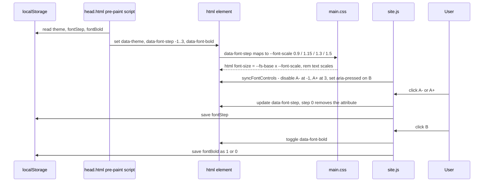

# Reader preferences: theme, text size, bold

Sources: `layouts/partials/head.html` (pre-paint script), `layouts/partials/header.html`
(buttons), `static/js/site.js` (click handlers), `static/css/main.css` (`data-*` rules).

